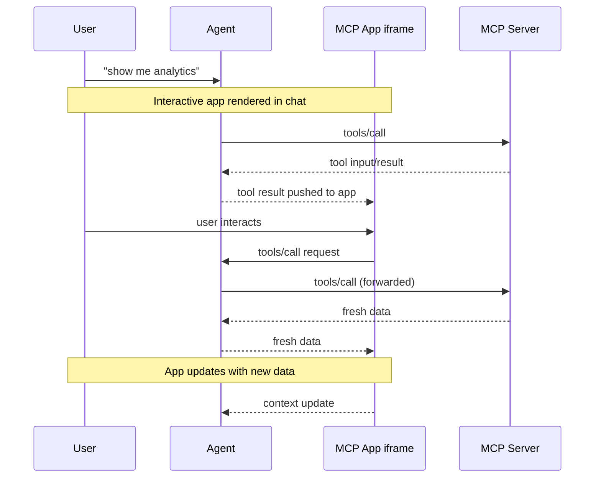

> ## 文档索引
> 请在 https://modelcontextprotocol.io/llms.txt 获取完整的文档索引。
> 在进一步探索之前，请先使用此文件了解所有可用页面。

# MCP Apps

> 在 Claude Desktop 等 MCP 宿主（host）中渲染的交互式 UI 应用

<Tip>
  有关完整的 API 文档、高级模式以及完整规范，请访问[官方 MCP Apps 文档](https://apps.extensions.modelcontextprotocol.io)。
</Tip>

纯文本回复的作用终究有限。有时用户需要与数据交互，而不仅仅是阅读数据。MCP Apps 让服务器能够返回交互式 HTML 界面（数据可视化、表单、仪表板），并直接在聊天中渲染。

<Frame caption="运行在 Claude 中的 Excalidraw MCP App">
  
</Frame>

## 为什么不直接构建一个 Web 应用？

你当然可以构建一个独立的 Web 应用，然后把链接发给用户。然而，MCP Apps 提供了独立页面无法比拟的几项关键优势：

* **上下文保留（Context preservation）。** 应用就存在于对话之中。用户无需切换标签页、忘记之前看到哪里，也不必纳闷哪个聊天线程里有那个仪表板。UI 就在那里，与引发它的讨论并排呈现。
* **双向数据流（Bidirectional data flow）。** 你的应用可以调用 MCP 服务器上的任何工具，宿主也可以把最新结果推送给你的应用。而独立的 Web 应用需要自己实现 API、认证和状态管理，MCP Apps 通过现有的 MCP 模式即可获得这些能力。
* **与宿主能力的集成（Integration with the host's capabilities）**。应用可以把操作委托给宿主，由宿主调用用户已连接的能力和工具（需经用户同意）。每个应用无需各自实现并维护直接集成（例如对接邮件服务提供商），只需请求一个结果（比如"帮我安排这场会议"），宿主就会通过用户现有的已连接能力来完成。
* **安全保障（Security guarantees）。** MCP Apps 运行在由宿主控制的沙箱化 iframe 中。它们无法访问父页面、窃取 cookie，也无法逃出容器。这意味着宿主可以安全地渲染第三方应用，而不必完全信任服务器作者。

如果你的用例无法从这些特性中获益，普通 Web 应用可能更简单。但如果你希望与基于 LLM 的对话深度集成，MCP Apps 是好得多的工具。

## MCP Apps 的工作原理

传统的 MCP 工具返回文本、图像、资源或结构化数据，由宿主作为对话的一部分进行展示。MCP Apps 对这一模式进行了扩展：工具可以在其描述中声明一个对交互式 UI 的引用，由宿主就地渲染。

其核心模式结合了两个 MCP 原语（primitive）：一个在描述中声明了 UI 资源的工具，以及一个把数据渲染为交互式 HTML 界面的 UI 资源。

当大语言模型（LLM）决定调用一个支持 MCP Apps 的工具时，会发生以下流程：

1. **UI 预加载（UI preloading）**：工具描述中包含一个指向 `ui://` 资源的 `_meta.ui.resourceUri` 字段。宿主可以在工具被调用之前就预加载该资源，从而支持将工具输入流式传输给应用等特性。

2. **资源获取（Resource fetch）**：宿主从服务器获取 UI 资源。该资源包含一个 HTML 页面，为简便起见通常会将 JavaScript 和 CSS 一并打包在内。应用也可以从 `_meta.ui.csp` 中指定的源（origin）加载外部脚本和资源。

3. **沙箱渲染（Sandboxed rendering）**：Web 宿主通常在对话内的沙箱化 [iframe](https://developer.mozilla.org/en-US/docs/Web/HTML/Element/iframe) 中渲染该 HTML。沙箱限制了应用对父页面的访问，从而确保安全性。资源的 `_meta.ui` 对象可以包含 `permissions`（用于请求额外能力，如麦克风、摄像头）和 `csp`（用于控制应用可以从哪些外部源加载资源）。

4. **双向通信（Bidirectional communication）**：应用与宿主通过一种 JSON-RPC 协议通信，该协议构成了 MCP 的一个专属方言。其中一些请求和通知与核心 MCP 协议共享（例如 `tools/call`），一些与之类似（例如 `ui/initialize`），而大多数则是新增的、带有 `ui/` 方法名前缀的方法。应用可以请求工具调用、发送消息、更新模型的上下文，并从宿主接收数据。

应用与宿主保持隔离，但仍能通过安全的 postMessage 通道调用 MCP 工具。

## 何时使用 MCP Apps

当你的用例涉及以下场景时，MCP Apps 是理想选择：

**探索复杂数据。** 用户问"按地区展示销售额"。文本回复可能只是列出一堆数字，而 MCP App 可以渲染一张交互式地图，用户可以点击地区进行下钻、悬停查看详情、在多个指标之间切换——这一切都无需额外的提示词。

**配置众多选项。** 设置一次部署涉及数十个相互关联的选择。与其来回对话（"选哪个地区？""实例规格多大？""是否启用自动扩缩容？"），不如让 MCP App 呈现一个表单，用户可以一眼看到所有选项，并自带校验和默认值。

**查看富媒体。** 当用户要求查看 PDF、浏览 3D 模型或预览生成的图像时，文字描述就显得力不从心。MCP App 可以将实际的查看器（平移、缩放、旋转）直接嵌入对话中。

**实时监控。** 展示实时指标、日志或系统状态的仪表板需要持续更新。MCP App 会维持持久连接，随着数据变化自动更新显示，无需用户反复询问"现在状态如何？"

**多步骤工作流。** 审批报销单、审查代码变更或对 issue 进行分类，都需要逐项检查。MCP App 提供导航控件、操作按钮，以及在多次交互之间保持的状态。

## 安全模型

MCP Apps 运行在沙箱化的
[iframe](https://developer.mozilla.org/docs/Web/HTML/Element/iframe) 中，
这为其与宿主应用之间提供了强隔离。沙箱可以阻止你的应用访问父窗口的
[DOM](https://developer.mozilla.org/docs/Web/API/Document_Object_Model)、
读取宿主的 cookies 或本地存储（local storage）、跳转父页面，或在父上下文中执行脚本。

你的应用与宿主之间的所有通信都通过
[postMessage API](https://developer.mozilla.org/docs/Web/API/Window/postMessage) 进行。
由宿主决定你的应用可以访问哪些能力（capability）。例如，宿主可能会限制应用可以调用
哪些工具，或禁用 `sendOpenLink` 能力。

沙箱的设计目的就是防止应用逃逸出去访问宿主或用户数据。

## 框架支持

MCP Apps 使用自己的 MCP 方言，与核心协议一样构建在 JSON-RPC 之上。其中一部分消息
与常规 MCP 共享（例如 `tools/call`），另一些则是应用特有的（例如 `ui/initialize`）。
传输层使用的是
[postMessage](https://developer.mozilla.org/docs/Web/API/Window/postMessage)，
而非 stdio 或 HTTP。由于底层全部是标准 Web 原语，你可以使用任意框架，或者完全不用框架。

`@modelcontextprotocol/ext-apps` 中的 `App` 类只是一个便捷封装，并非必需。如果你希望
避免引入依赖，或者需要更精细的控制，可以直接实现
[postMessage 协议](https://github.com/modelcontextprotocol/ext-apps/blob/main/specification/2026-01-26/apps.mdx)。

[示例目录](https://github.com/modelcontextprotocol/ext-apps/tree/main/examples)
中提供了 React、Vue、Svelte、Preact、Solid 以及原生 JavaScript（vanilla JavaScript）
的入门模板。这些示例展示了各自框架体系下的推荐模式，但它们只是示例，并非强制要求。
你可以根据自身用例选择最合适的方案。

## 客户端支持

<Note>
  MCP Apps 是对[核心 MCP 规范](/specification/latest)的扩展。各客户端对宿主（host）的支持情况有所不同。
</Note>

目前支持 MCP Apps 的客户端包括 [Claude](https://claude.ai)、
[Claude Desktop](https://claude.ai/download)、
[VS Code GitHub Copilot](https://code.visualstudio.com/)、[Microsoft 365 Copilot](https://www.microsoft.com/microsoft-365-copilot)、[Goose](https://block.github.io/goose/)、[Postman](https://postman.com)、[MCPJam](https://www.mcpjam.com/) 和 [Archestra.AI](https://www.archestra.ai/)。各客户端对扩展的完整支持列表请参见
[客户端支持矩阵](/extensions/client-matrix)。

如果你正在构建 MCP 客户端并希望支持 MCP Apps，有两种选择：

1. **使用现成框架**：[`@mcp-ui/client`](https://github.com/MCP-UI-Org/mcp-ui)
   包提供了一组 React 组件，用于在你的宿主应用中渲染 MCP Apps 视图并与之交互。
   用法详情请参见
   [MCP-UI 文档](https://mcpui.dev/)。

2. **基于 AppBridge 构建**：SDK 内置了一个
   [**App Bridge**](https://apps.extensions.modelcontextprotocol.io/api/modules/app-bridge.html)
   模块，负责在沙箱化 iframe 中渲染应用、传递消息、代理工具调用以及执行安全策略。
   [basic-host 示例](https://github.com/modelcontextprotocol/ext-apps/tree/main/examples/basic-host)
   展示了如何集成它。

实现细节请参见 [API 文档](https://apps.extensions.modelcontextprotocol.io/api/)。

## 示例

[ext-apps 仓库](https://github.com/modelcontextprotocol/ext-apps/tree/main/examples)
中包含多个可直接运行的示例，覆盖了不同的使用场景：

* **3D 与可视化**：
  [map-server](https://github.com/modelcontextprotocol/ext-apps/tree/main/examples/map-server)
  （CesiumJS 地球仪）、
  [threejs-server](https://github.com/modelcontextprotocol/ext-apps/tree/main/examples/threejs-server)
  （Three.js 场景）、
  [shadertoy-server](https://github.com/modelcontextprotocol/ext-apps/tree/main/examples/shadertoy-server)
  （着色器效果）
* **数据探索**：
  [cohort-heatmap-server](https://github.com/modelcontextprotocol/ext-apps/tree/main/examples/cohort-heatmap-server)、
  [customer-segmentation-server](https://github.com/modelcontextprotocol/ext-apps/tree/main/examples/customer-segmentation-server)、
  [wiki-explorer-server](https://github.com/modelcontextprotocol/ext-apps/tree/main/examples/wiki-explorer-server)
* **业务应用**：
  [scenario-modeler-server](https://github.com/modelcontextprotocol/ext-apps/tree/main/examples/scenario-modeler-server)、
  [budget-allocator-server](https://github.com/modelcontextprotocol/ext-apps/tree/main/examples/budget-allocator-server)
* **媒体**：
  [pdf-server](https://github.com/modelcontextprotocol/ext-apps/tree/main/examples/pdf-server)、
  [video-resource-server](https://github.com/modelcontextprotocol/ext-apps/tree/main/examples/video-resource-server)、
  [sheet-music-server](https://github.com/modelcontextprotocol/ext-apps/tree/main/examples/sheet-music-server)、
  [say-server](https://github.com/modelcontextprotocol/ext-apps/tree/main/examples/say-server)
  （文字转语音）
* **实用工具**：
  [qr-server](https://github.com/modelcontextprotocol/ext-apps/tree/main/examples/qr-server)、
  [system-monitor-server](https://github.com/modelcontextprotocol/ext-apps/tree/main/examples/system-monitor-server)、
  [transcript-server](https://github.com/modelcontextprotocol/ext-apps/tree/main/examples/transcript-server)
  （语音转文字）
* **入门模板**：
  [React](https://github.com/modelcontextprotocol/ext-apps/tree/main/examples/basic-server-react)、
  [Vue](https://github.com/modelcontextprotocol/ext-apps/tree/main/examples/basic-server-vue)、
  [Svelte](https://github.com/modelcontextprotocol/ext-apps/tree/main/examples/basic-server-svelte)、
  [Preact](https://github.com/modelcontextprotocol/ext-apps/tree/main/examples/basic-server-preact)、
  [Solid](https://github.com/modelcontextprotocol/ext-apps/tree/main/examples/basic-server-solid)、
  [vanilla JavaScript](https://github.com/modelcontextprotocol/ext-apps/tree/main/examples/basic-server-vanillajs)

要开始构建你自己的 MCP App，请参见[构建指南](/extensions/apps/build)。
